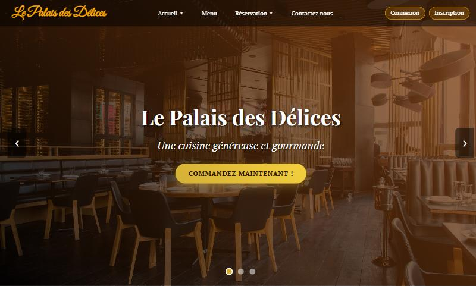
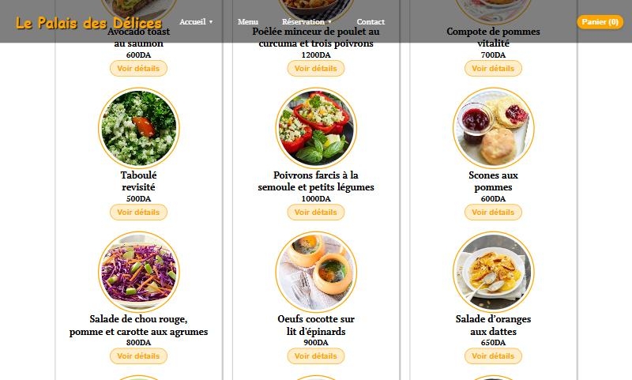
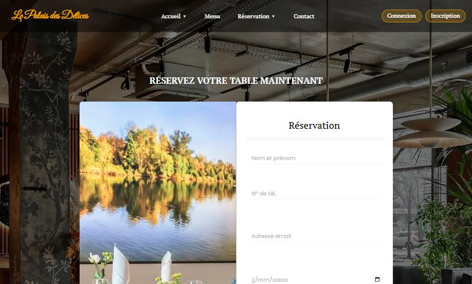
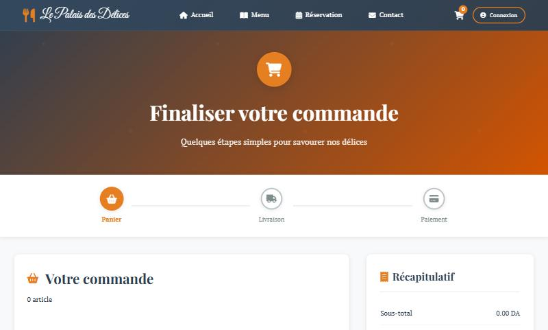
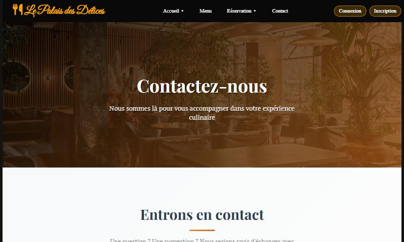

<div align="center">

# 🍽️ Le Palais des Délices

**Site web d'un restaurant : menu, réservation de table, commande en ligne et espace client**

*Projet de fin de cycle — Licence (2024-2025)*


</div>

> 🚧 **Projet non finalisé** — réalisé dans le cadre de mon projet de fin de cycle de licence. Les bases (site, API, authentification) sont en place ; certaines fonctionnalités restent à terminer (voir [Avancement](#-avancement)).

---

## 📸 Aperçu



| Menu | Réservation |
|:---:|:---:|
|  |  |
| **Commande** | **Contact** |
|  |  |

---

## 🎯 Présentation

**Le Palais des Délices** est un site pour un restaurant. Il permet aux clients de découvrir la carte, de **réserver une table**, de **passer commande** et de gérer leur compte.

Le projet est découpé en deux parties :

- un **front-end** en HTML, CSS et JavaScript : les pages que voit le client ;
- un **back-end** en **Django REST Framework** : une API qui gère les utilisateurs, le menu, les réservations, les commandes et les paiements.

## ✨ Fonctionnalités

**Site client (front-end)**
- Page d'accueil avec carrousel et vidéo de présentation
- Carte du restaurant : menus, catégories, plats et spécialités
- Formulaire de réservation de table
- Page de commande et page de contact
- Connexion / inscription, avec gestion automatique des jetons de connexion (`api.js`)

**API (back-end)**

| Module | Rôle | Exemples de routes |
|---|---|---|
| `authentication` | Comptes utilisateurs, connexion par **JWT**, profil, changement de mot de passe | `/api/auth/register/`, `/api/auth/login/`, `/api/auth/profile/` |
| `menu` | Menus, catégories, plats, spécialités, recherche | `/api/menu/plats/`, `/api/menu/categories-with-plats/` |
| `restaurant` | Tables et réservations | `/api/restaurant/tables/disponibles/`, `/api/restaurant/reservations/` |
| `orders` | Commandes et lignes de commande | `/api/orders/commandes/` |
| `payments` | Paiements et remboursements | `/api/payments/paiements/` |
| `dashboard` | Tableau de bord d'administration | *(à développer)* |

L'interface d'administration de Django (`/admin/`) permet de gérer tout le contenu : plats, tables, réservations, commandes…

## 📈 Avancement

| Partie | État |
|---|---|
| Pages du site (accueil, menu, réservation, commande, contact) | ✅ Réalisées |
| API : authentification, menu, réservations, commandes, paiements | ✅ Réalisée |
| Connexion du site à l'API (authentification, menu, réservation) | ✅ En place |
| Envoi des commandes et du formulaire de contact vers l'API | 🔧 À terminer |
| Paiement en ligne côté site | 🔧 À terminer |
| Tableau de bord (`dashboard`) | 🔧 À développer |

## 🏗️ Structure du projet

```
palais-delices/
├── frontend/                 # Site client
│   ├── index.html            # Accueil
│   ├── menu.html             # Carte du restaurant
│   ├── reservation.html      # Réservation de table
│   ├── commande.html         # Commande
│   ├── contact.html          # Contact
│   ├── style*.css            # Styles de chaque page
│   ├── js/                   # Scripts (api.js = communication avec l'API)
│   └── image/                # Images du site
│
└── backend/                  # API Django
    ├── manage.py
    ├── requirements.txt
    ├── palais_delices/       # Configuration (settings, urls, .env.example)
    ├── authentication/       # Utilisateurs et JWT
    ├── menu/                 # Menus, catégories, plats
    ├── restaurant/           # Tables et réservations
    ├── orders/               # Commandes
    ├── payments/             # Paiements
    └── dashboard/            # Tableau de bord (à développer)
```

## 🚀 Installation et lancement

**Prérequis :** Python 3.10+, MySQL (par exemple avec XAMPP).

**1. Récupérer le projet**

```bash
git clone https://github.com/melissameziani/palais-delices.git
cd palais-delices/backend
```

**2. Installer les dépendances**

```bash
pip install -r requirements.txt
```

**3. Configurer**

Créez la base de données MySQL `palais_delices_db`, puis copiez le fichier de configuration et adaptez-le (mot de passe MySQL, clé secrète) :

```bash
cp palais_delices/.env.example palais_delices/.env
```

**4. Créer les tables et un compte administrateur**

```bash
python manage.py migrate
python manage.py createsuperuser
```

**5. Lancer l'API**

```bash
python manage.py runserver 8001
```

L'API est disponible sur http://127.0.0.1:8001/api/ et l'administration sur http://127.0.0.1:8001/admin/.

> Le site est configuré pour appeler l'API sur le port **8001** (fichier `frontend/js/api.js`, réglage `BASE_URL`).

**6. Lancer le site**

Dans un second terminal, depuis le dossier `frontend` :

```bash
python -m http.server 5500
```

Puis ouvrez http://localhost:5500.

## 🛠️ Technologies

| Back-end | Front-end | Outils |
|---|---|---|
| Python · Django 4.2 | HTML5 · CSS3 | Git · GitHub |
| Django REST Framework | JavaScript (vanilla, `fetch`) | VS Code |
| Simple JWT · django-cors-headers | Font Awesome · Google Fonts | |
| MySQL | | |

## 👩‍💻 Autrice

**Melissa MEZIANI** — Développeuse web full stack
[GitHub](https://github.com/melissameziani) · [LinkedIn](https://www.linkedin.com/in/melissa-meziani-b0ba4b299) · [mezianimelissa37@gmail.com](mailto:mezianimelissa37@gmail.com)
